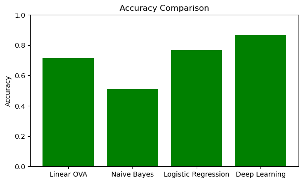

# Handwritten Digit Recognition

A machine learning project that teaches computers to **read handwritten digits (0–9)**.
I implemented classic models **from scratch with NumPy**, compared them with library versions, and built a **neural network in TensorFlow/Keras**, which turned out to be the most accurate.



## Dataset
- **10,000 images** of handwritten digits, **1,000 per digit**, stored in folders `10000/0` … `10000/9`
- Each image is converted to **grayscale**, resized to **28×28 pixels**, and scaled to values between 0 and 1
- Split into **8,000 training** and **2,000 test** images

## Models
| Model | How it was built | Test accuracy |
|-------|------------------|---------------|
| **Neural network** | Keras: 3 hidden layers × 512 neurons (ReLU + L2 regularization), softmax output | **~87%** |
| Logistic regression | From scratch (one-vs-all, mini-batch gradient descent, L2) and with scikit-learn | ~75% / ~77% |
| Linear classifier | From scratch (one-vs-all linear regression on each digit) | ~71% |
| Naive Bayes | scikit-learn `GaussianNB` | ~51% |

The F1-scores follow the same ranking ([chart](results/f1_comparison.png)).

## What I did
1. **Data pipeline:** loaded the images with Pillow, converted them to NumPy arrays, normalized them, and flattened each one into 784 features.
2. **Models from scratch:** wrote the sigmoid function, one-vs-all training, mini-batches and L2 regularization myself instead of calling a library.
3. **Hyperparameter tuning:**
   - Logistic and linear models: grid search over learning rate, epochs, tolerance and L2 strength, scored with **K-fold cross-validation**.
   - Neural network: grid search over number of layers, layer size, activation (ReLU / sigmoid), optimizer (SGD / RMSprop), learning rate and batch size.
4. **Evaluation:** accuracy, precision, recall, macro F1-score, classification reports and confusion matrices.
5. **Saving models:** the best neural network is saved as `best_model.keras`.

## Why the neural network wins
Linear models can only draw straight boundaries between digits. Handwriting varies a lot (a "7" with or without a line, a "4" open or closed), so the neural network's hidden layers learn more complex patterns, like curves and strokes, from combinations of pixels.

## How to run
```bash
pip install -r requirements.txt
jupyter notebook digit_recognition.ipynb
```
Keep the `10000` dataset folder next to the notebook, then run the cells from top to bottom. Grid search takes a while.

## Built with
Python, NumPy, pandas, Pillow, scikit-learn, TensorFlow/Keras, Matplotlib, Seaborn
